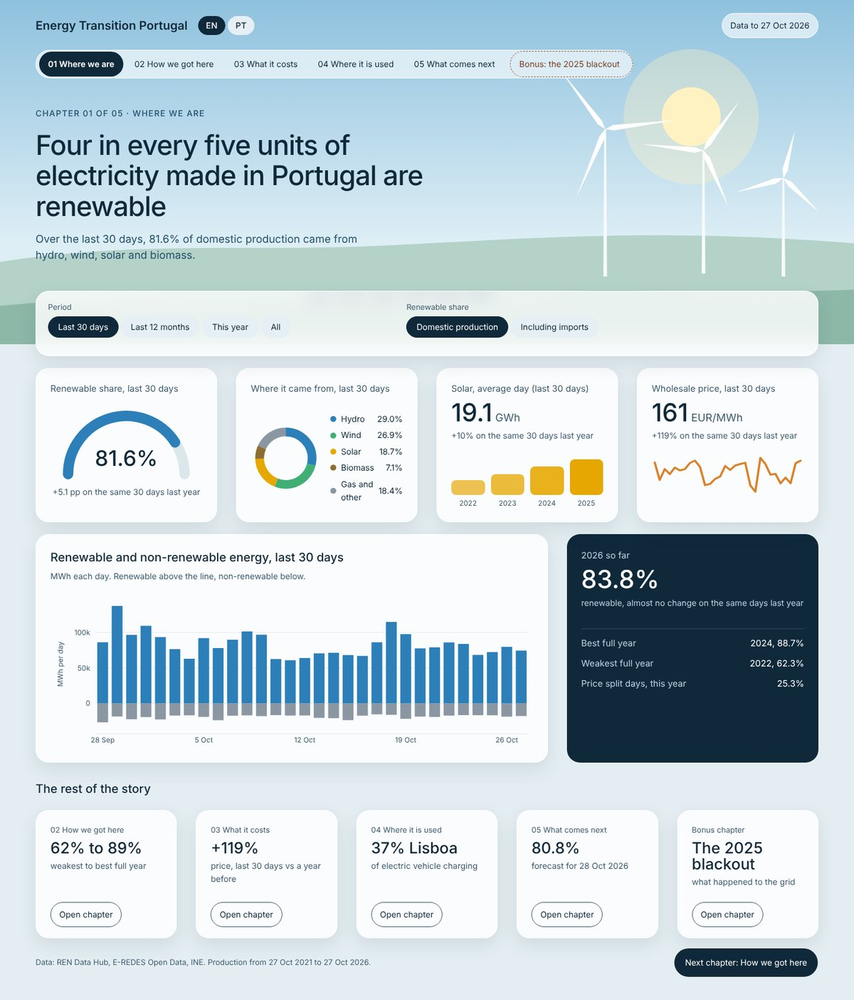
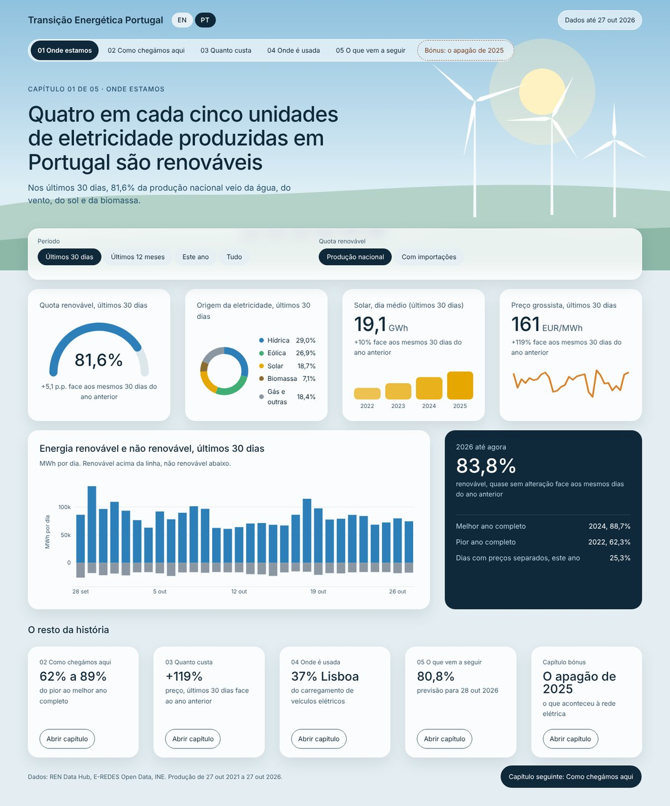
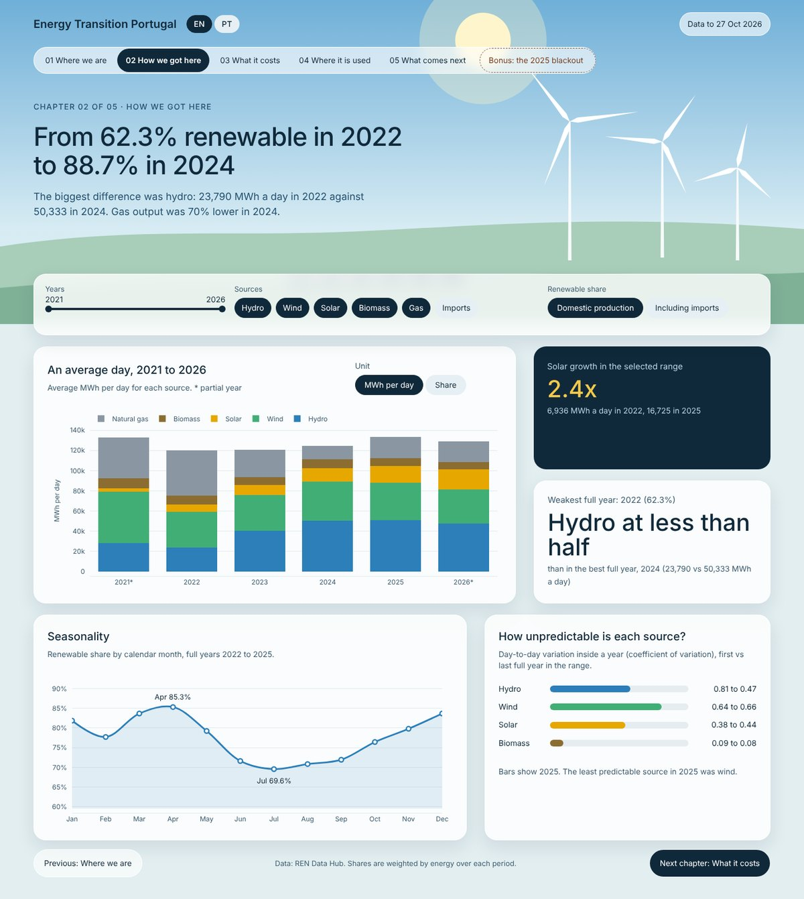
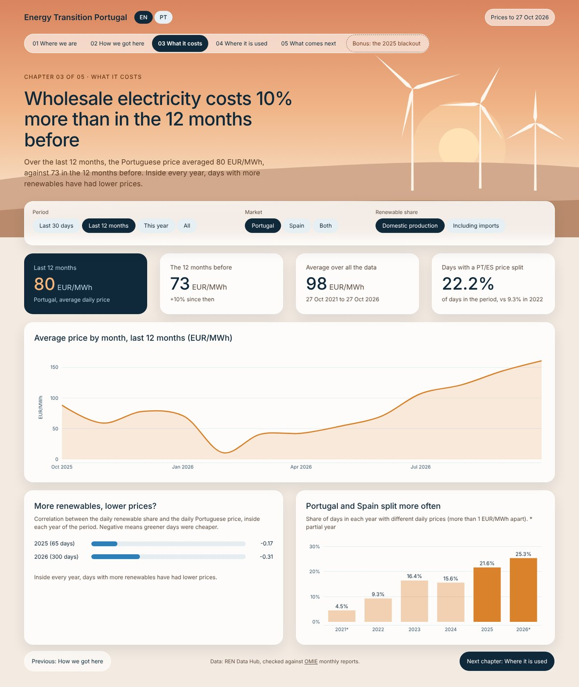
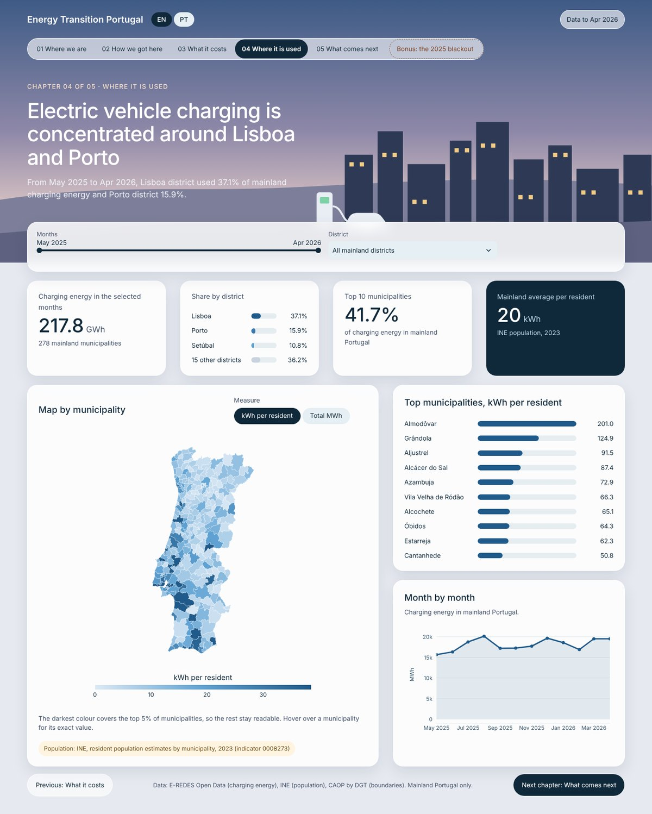
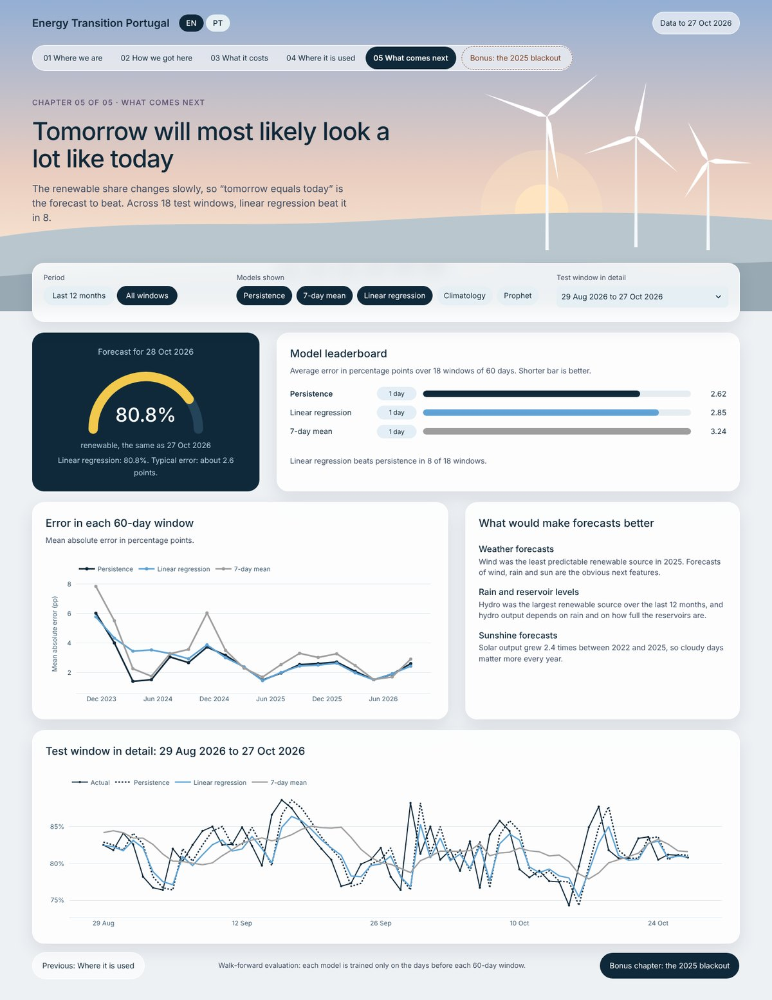
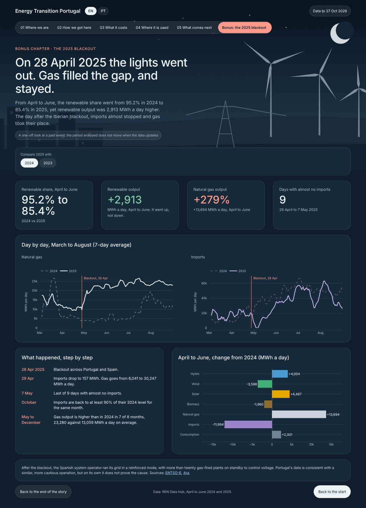
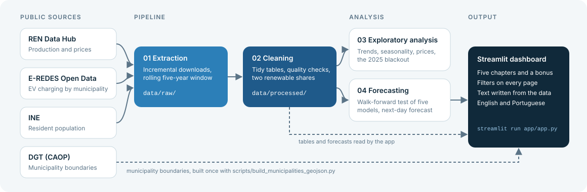

# Energy Transition & Electric Mobility in Portugal

How green is Portugal's electricity, what does it cost, and where are electric cars charged? This project answers those three questions with public data and puts the answers in an interactive dashboard that reads like a short story: five chapters and a bonus, in English and Portuguese.

The data comes from the grid operator (REN), the distribution network operator (E-REDES) and Statistics Portugal (INE). The pipeline works on a rolling five-year window and runs every morning on GitHub Actions, so the dashboard always shows data up to yesterday.

**Live dashboard:** [energy-transition-portugal.streamlit.app](https://energy-transition-portugal.streamlit.app)

[](https://github.com/JoaoFelicissimo03/PT-Energy-Transition-Analytics/actions/workflows/update-data.yml)

<table>
  <tr>
    <td align="center"><b>English</b></td>
    <td align="center"><b>Português</b></td>
  </tr>
  <tr>
    <td></td>
    <td></td>
  </tr>
</table>

## What the dashboard covers

| Chapter | Question | What you can change |
|---|---|---|
| 01 Where we are | How much of the electricity made in Portugal is renewable right now? | Period, domestic production or including imports |
| 02 How we got here | How did the mix change since 2021, and how does it vary through the year? | Years, sources |
| 03 What it costs | Do renewables push wholesale prices down? | Period, Portugal, Spain or both |
| 04 Where it is used | Where is electric vehicle charging concentrated? | Months, district, total or per resident |
| 05 What comes next | Can tomorrow's renewable share be forecast, and how well? | Period, models, test window |
| Bonus: the 2025 blackout | What happened to the electricity mix after 28 April 2025? | Comparison year |

Every title, sentence and figure is written from the data at the moment the page loads. If the pipeline brings in a new month, or a filter changes, the text changes with it. The language can be switched at the top of any page, and the choice is kept in the link (`?lang=pt` or `?lang=en`).

## Findings

These come from the run of 28 October 2026, with data from 27 October 2021 to 27 October 2026. They shift a little each time the window moves forward, while the dashboard always shows the latest run.

- **Renewables grew, but not in a straight line.** Domestic production was 62.3% renewable in 2022, 77.2% in 2023 and 88.7% in 2024, then 83.8% in 2025. 2022 was a weak year for hydro, which averaged about 23,800 MWh a day, less than half of 2024.
- **Solar kept climbing.** Average daily solar output rose from about 6,900 MWh in 2022 to 16,700 MWh in 2025, 2.4 times more.
- **The 2025 dip came from gas, not from a shortfall in renewables.** From April to June, renewable output was 2,913 MWh a day higher than a year earlier, yet the share fell from 95.2% to 85.4%. Imports dropped to almost nothing for nine days after the blackout of 28 April, and gas output stayed well above its 2024 level from May to November.
- **Greener days are cheaper days.** Inside each year, the daily renewable share and the daily Portuguese price are negatively correlated, from about -0.3 to -0.75. Portugal and Spain also see different prices more often: 9.3% of days in 2022, 21.6% in 2025.
- **Electric vehicle charging is concentrated.** Over the 12 months available, Lisbon district accounts for 37.1% of mainland charging energy and Porto district for 15.9%. The ten largest municipalities add up to 41.7%.
- **"Tomorrow equals today" is hard to beat.** Across 18 test windows of 60 days, that simple forecast has an average error of 2.62 percentage points. A linear regression with the previous day, the previous week and the time of year scores 2.85 and wins in 8 of the 18 windows. Looking only at the latest window would have suggested the regression is better, which is why the evaluation uses many windows.

<table>
  <tr>
    <td></td>
    <td></td>
  </tr>
  <tr>
    <td></td>
    <td></td>
  </tr>
  <tr>
    <td></td>
    <td></td>
  </tr>
</table>

## How it works



The four notebooks run in order and each one only reads what the previous one wrote.

1. **`01_extraction`** downloads the sources into `data/raw/`. It is incremental: a run asks only for the days it does not have yet, retries gaps, and moves the window forward to yesterday. E-REDES keeps about twelve months online, so each run merges its download with the history already saved, and that file is kept in the repository.
2. **`02_cleaning`** turns the raw JSON into tidy tables in `data/processed/`. Power readings every 15 minutes become energy in MWh, days with clock changes are checked, and a source with no readings is left empty instead of being filled with zero. Prices are cross-checked against the monthly report published by OMIE.
3. **`03_eda`** explores the questions above and ends with the findings listed in this README.
4. **`04_predictive_model`** compares five forecasting models with a walk-forward evaluation and saves the results for the dashboard.

Every morning, the workflow in `.github/workflows/update-data.yml` runs notebooks 01, 02 and 04, checks the new tables with `scripts/check_processed.py` and runs the tests. It commits the new tables only if all of that passes, and Streamlit Community Cloud then reloads the app with them. The large REN downloads are kept between runs in the GitHub Actions cache, so a normal run only asks REN for the days it does not have yet.

A few choices worth knowing about:

- **Two definitions of the renewable share.** One uses domestic production only. The other adds imports to the denominator and counts them all as non-renewable. Official figures use the import balance, so they usually fall between the two. The dashboard lets you switch between them.
- **Shares are weighted by energy.** The share for a month or a year is renewable MWh divided by total MWh, not the average of daily percentages, which would give a quiet day the same weight as a busy one.
- **Walk-forward evaluation.** The recent history is cut into consecutive 60-day windows, and each model is trained only on the days before a window. One test window can flatter or punish a model depending on how calm that period was.
- **Correlation is checked inside each year.** Pooling all years mixes the 2021-22 gas price crisis with the growth of solar, and a shared trend alone can create a correlation.
- **Tests.** `tests/` covers the calculations, the generated sentences in both languages, and every page of the app under different filter combinations.

## Data sources

| Source | Used for | Access | Terms |
|---|---|---|---|
| [REN Data Hub](https://datahub.ren.pt/) | Daily electricity production by source, wholesale market prices for Portugal and Spain | JSON API | Published by REN as open data |
| [E-REDES Open Data](https://e-redes.opendatasoft.com/) | Electric vehicle charging energy by month and municipality (mainland) | OpenDataSoft API | CC BY 4.0 |
| [INE](https://www.ine.pt/) | Resident population by municipality | JSON API | Source cited as Statistics Portugal (INE) |
| [DGT, Carta Administrativa Oficial de Portugal](https://www.dgterritorio.gov.pt/) | Municipality boundaries, through a GeoJSON conversion by [nmota/caop_GeoJSON](https://github.com/nmota/caop_GeoJSON) | File, rebuilt with `scripts/build_municipalities_geojson.py` | CC BY 4.0 |
| [OMIE](https://www.omie.es/) | Cross-check of the monthly average prices | Monthly report | Used for checking only, not redistributed |

Geographic information provided by Direção-Geral do Território (*Informação geográfica cedida pela Direção-Geral do Território*).

The tables in `data/processed/` are derived from these sources. The REN downloads (about 23 MB) are left out of the repository and rebuilt by the pipeline. The small E-REDES and INE downloads are kept, because E-REDES only keeps about twelve months online.

## Run it

Python 3.10 or newer (tested with 3.13). The processed tables are included, so the dashboard works straight after installing.

```bash
python -m venv .venv
source .venv/bin/activate        # Windows: .venv\Scripts\activate
pip install -r requirements.txt
streamlit run app/app.py
```

The dashboard opens in the language of the browser. To force one, add `?lang=pt` or `?lang=en` to the address.

The deployed app installs `app/requirements.txt` instead, which holds only the four packages the dashboard needs.

To refresh the data, run the notebooks in order (`jupyter lab`, then `01` to `04`). The first run downloads the whole five-year window, and later runs only fetch the missing days. To run the tests:

```bash
pytest
```

The tests of the app need the files in `data/processed/` and are skipped without them.

## Project structure

```
.github/workflows/    Daily data update
app/                  Streamlit dashboard
  app.py              Entry point and navigation
  requirements.txt    Packages for the deployed app
  chapters/           One file per chapter
  core/               Data loading, calculations, sentences, charts, styles, translations
data/
  raw/                E-REDES and INE downloads (the REN ones are rebuilt by the pipeline)
  processed/          Tables written by the notebooks and read by the app
  reference/          Municipality boundaries (GeoJSON)
notebooks/            01 extraction, 02 cleaning, 03 exploratory analysis, 04 forecasting
scripts/              Rebuilds the boundaries file and checks the processed tables
tests/                Unit tests and page tests in both languages
docs/                 Images used in this README
```

## Limits

- **Charging data is short and covers the mainland only.** E-REDES publishes about twelve months, so there is no long-term trend for electric mobility yet. The Azores and Madeira are not included.
- **Per-resident figures need care.** Population is a single year from INE (2023), while charging covers May 2025 to April 2026. Small municipalities with busy chargers can top the ranking, because the charging energy of people passing through is divided by few residents.
- **The price link is a correlation.** Greener days are cheaper, but gas prices, demand and interconnection capacity also move the price, and the data here does not separate them.
- **The forecasts only see the series itself.** They know nothing about the weather, which drives most of the day-to-day change in wind, hydro and solar output. Weather forecasts are the obvious next input.
- **The blackout chapter is a fixed look at one event.** The data is consistent with a more cautious operation of the grid after the blackout, but it cannot prove the cause.

## Possible next steps

- Add weather data to the forecasting models.
- Extend the charging analysis as E-REDES history accumulates.

## Licence

MIT. See `LICENSE`.
